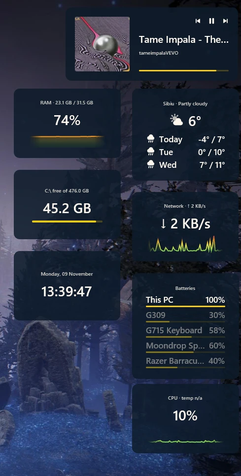
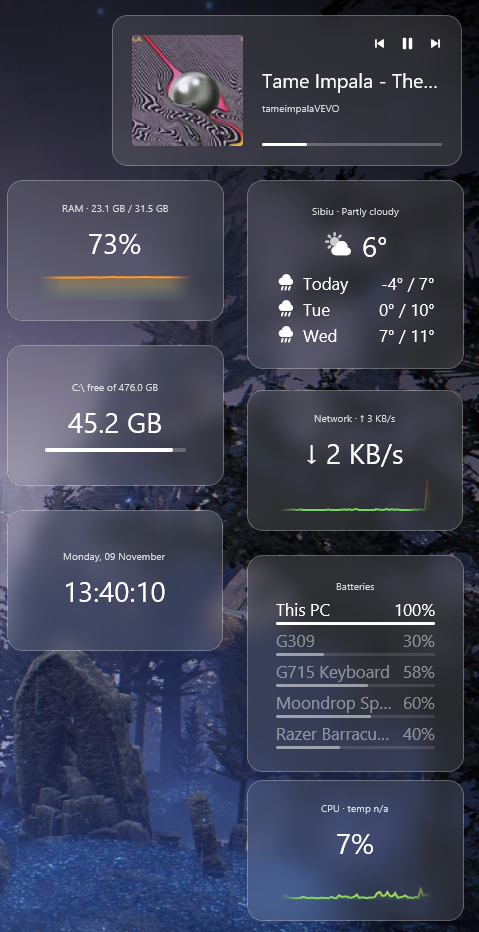
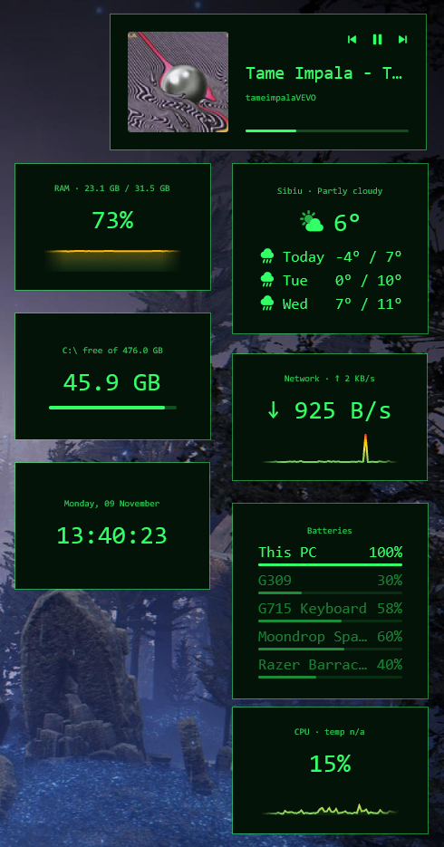
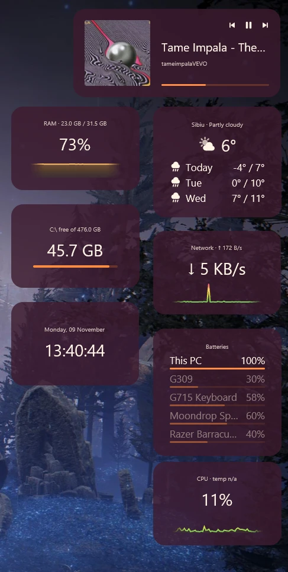
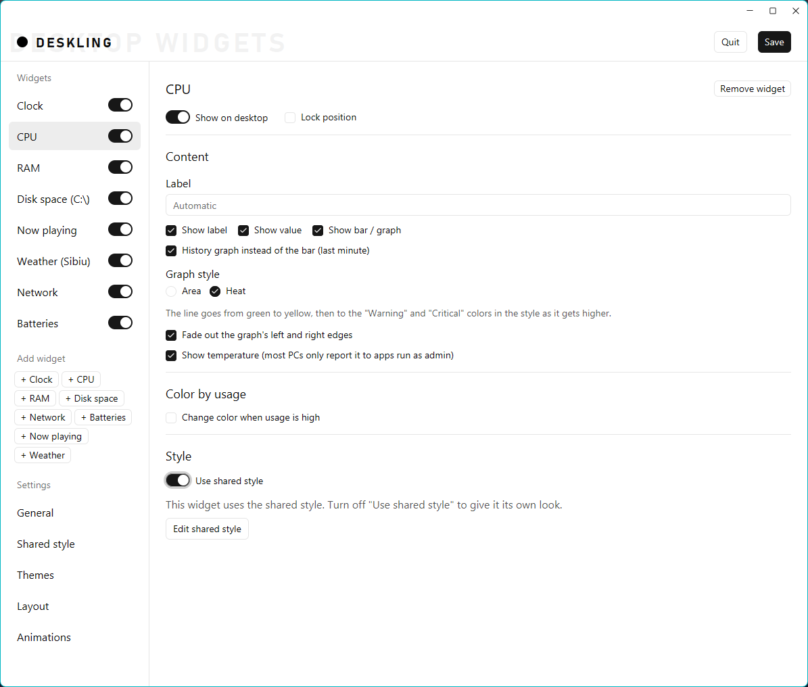
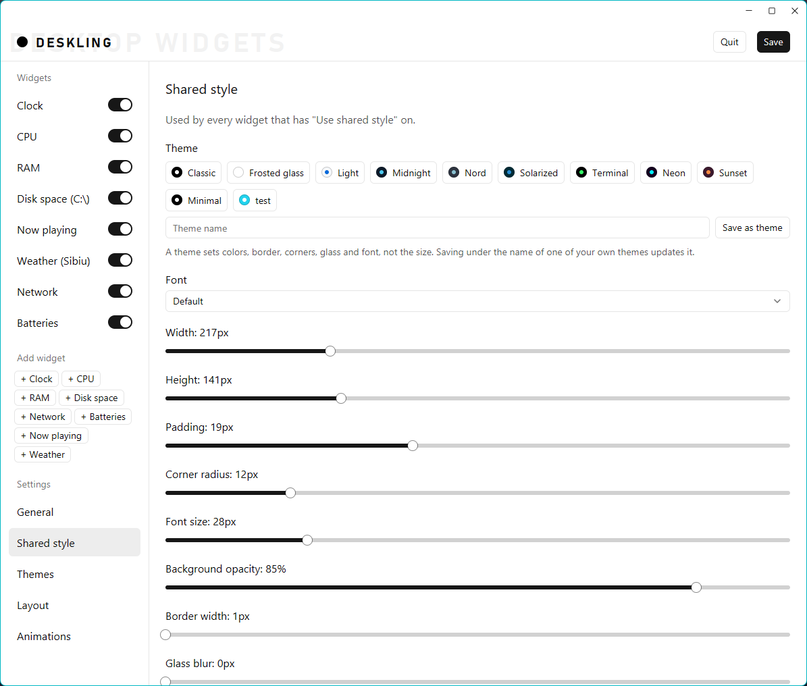
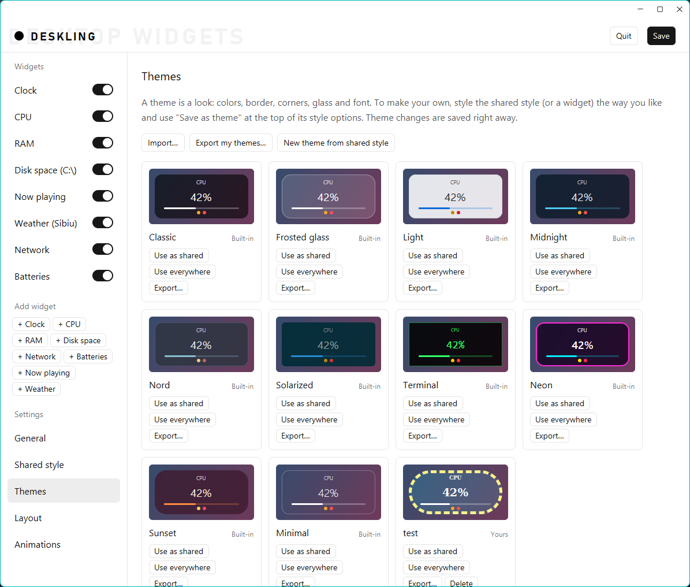
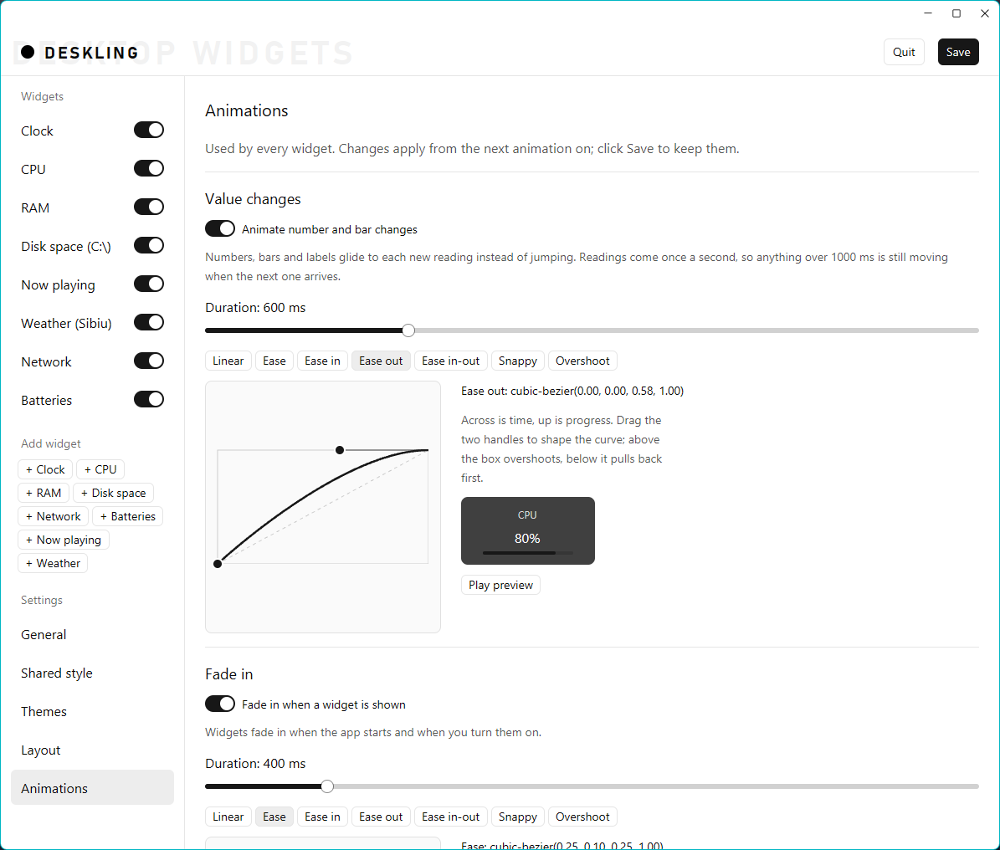

<p align="center">
  
</p>

<h1 align="center">Deskling</h1>

<p align="center">
  Small, good-looking desktop widgets for Windows, written in Rust with <a href="https://www.gpui.rs/">GPUI</a>.
</p>

<p align="center">
  <a href="https://github.com/IvanoiuPetrut/deskling/releases/latest"><b>Download for Windows</b></a>
</p>

Deskling puts widgets on your desktop (a clock, CPU, RAM, disk space, network, batteries, what's
playing, the weather), a bit like Rainmeter skins. A dashboard window lets you add, remove and
style them, and a tray icon keeps the app out of the way.

<table>
  <tr>
    <td align="center"><br><sub>Midnight</sub></td>
    <td align="center"><br><sub>Frosted glass</sub></td>
    <td align="center"><br><sub>Terminal</sub></td>
    <td align="center"><br><sub>Sunset</sub></td>
  </tr>
</table>

## Features

- **Eight widget types**: clock, CPU, RAM, disk space, network, batteries, now playing and weather.
  Add as many as you like, including several of the same type.
- **On the desktop layer**: widgets sit right above the wallpaper, below every normal window, and
  stay visible after Win+D.
- **Styling**: size, padding, corners, any installed font, borders, colors, background opacity and
  a glass blur of the desktop behind each widget. Use one shared style, or give a widget its own.
- **Themes**: ten built in, plus your own. Save, import and export them as plain JSON.
- **History graphs and usage colors**: a chart of the last minute, and warning or critical colors
  when usage gets high.
- **Now playing** controls for Spotify, browsers and most other players.
- **Weather** from [Open-Meteo](https://open-meteo.com/): no account or API key needed.
- **Tray icon** and **Start with Windows**.

## Download

Grab the zip from the [latest release](https://github.com/IvanoiuPetrut/deskling/releases/latest),
unzip it and run `deskling.exe`. There's no installer, and it needs Windows 10 or 11.

The program isn't code-signed, so Windows SmartScreen warns you the first time ("Windows protected
your PC"). Click **More info**, then **Run anyway**, or build it yourself as described below.

## Requirements

- Windows 10 or 11. The widgets use Windows APIs; the dashboard also builds on other platforms.
- [Rust](https://rustup.rs/) (installing `rustup` also installs `cargo`), with the MSVC toolchain.
- The Windows SDK, for `rc.exe`, which puts the app icon into the program. It comes with the
  "Desktop development with C++" workload of the Visual Studio Build Tools, which Rust's MSVC
  toolchain needs anyway.

## Building and running

```bash
git clone https://github.com/IvanoiuPetrut/deskling.git
```

```bash
cd deskling
```

```bash
cargo run --release
```

The first build downloads and compiles every dependency, so it takes a few minutes. Later builds
only recompile what changed. The program lands in `target\release\deskling.exe`; you can copy it
anywhere, it needs no other files.

Closing the dashboard only hides it: the widgets keep running and the app stays in the tray
(notification area). Click the tray icon to open the dashboard again. To stop the app, use **Quit**
in the dashboard or right-click the tray icon and pick **Quit**.

Start with `--hidden` to show only the widgets and the tray icon:

```bash
cargo run --release -- --hidden
```

| Command | What it does |
|---|---|
| `cargo run` | Debug build, then start the app |
| `cargo run --release` | Optimized build: slower to compile, faster and lighter to run |
| `cargo check` | Only check that the code compiles; faster than a build |
| `cargo build --release` | Build without starting |

## Using it

### The dashboard

The window that opens is the dashboard. On the left is the list of widgets, each with a switch
that shows or hides it on the desktop; click a widget to see its options on the right. **Add widget**
adds a new one (for example two Disk widgets, for C: and D:), and **Remove widget** on its options
page removes it. **Save** keeps everything for the next start.

<table>
  <tr>
    <td align="center"><br><sub>A widget's options</sub></td>
    <td align="center"><br><sub>Shared style</sub></td>
  </tr>
  <tr>
    <td align="center"><br><sub>Themes</sub></td>
    <td align="center"><br><sub>Animations</sub></td>
  </tr>
</table>

| Widget | Shows | Options |
|---|---|---|
| Clock | time and date | 12/24-hour, seconds, date format, another time zone (UTC offset) |
| CPU | usage in %, and the temperature | show temperature, history graph |
| RAM | used / total and % | history graph |
| Disk space | free space on one drive | which drive |
| Network | download and upload speed (all adapters) | history graph |
| Batteries | one row per battery: this PC's, and Bluetooth mice, keyboards, headsets | which devices, your own names, switched-off devices |
| Now playing | cover art, title, artist, progress, and previous / play-pause / next buttons | cover art, buttons |
| Weather | temperature and sky in one city, with an icon; optionally today and the next 2 days | city, °C / °F, forecast rows |

Every widget also has:

- **Label**: your own text instead of the automatic one (e.g. "Tokyo" for a world clock).
- **Show label / value / bar**: hide the parts you don't want.
- **History graph** (CPU, RAM, network): replaces the bar with a chart of the last minute.
- **Lock position**: the widget can't be dragged.
- **Color by usage** (CPU, RAM, disk): above the warning or critical % the value, bar and graph
  switch to the style's Warning / Critical colors. For disks it's the used space.

The **Layout** page has **Snap to grid** (widgets move in grid steps while you drag them, grid size
5–100 px) and **Lock all / Unlock all**.

### The widgets

- Drag a widget anywhere to move it, then click **Save** in the dashboard to keep the position.
- **Glass blur** blurs the desktop behind a widget. Windows' own blur effects don't work on GPUI
  windows, so Deskling takes a picture of the desktop and blurs it itself. The picture is retaken
  every 10 seconds, so a new wallpaper shows up with a short delay.
- **Batteries** lists the battery levels Windows shows in Settings → Bluetooth & devices, plus the
  laptop's own battery. It reads them every 15 seconds and grows taller to fit every row. Switched-off
  devices are left out unless you turn on **Also show devices that are switched off**; they're then
  faded, with the last level Windows heard. Its **Low battery** colors start on (warning at 30% or
  less, critical at 15% or less).
- **Now playing** shows what Windows shows in its media pop-up next to the volume overlay. Its
  buttons work like that pop-up's; a button the player doesn't allow right now (like "previous" on
  the first track) is faded. When several apps are playing, Windows picks which one. The progress
  bar only shows when the player reports the track's length (live streams don't).
- **Weather**: type a city in its options and pick it from the list. The weather is fetched every
  15 minutes; without an internet connection the widget keeps the last weather it got and adds
  "offline" to its label. **Show today and the next 2 days** adds a row per day.

### Styles and themes

Each widget either uses the **Shared style** (the default) or, with **Use shared style** turned off,
its own style. A style covers size, padding, corner radius, font (any installed font, weight, size,
and the label's size), background opacity, border (none / solid / dashed) and width, glass blur,
and the colors: text, background, border, bars & graphs, warning and critical.

A **theme** is a named look: colors, background opacity, border, corner radius, glass blur and
font. Applying one leaves the size, padding and font size alone, so it never breaks a layout.

- **Pick a theme** at the top of any style editor. The app comes with Classic, Frosted glass, Light,
  Midnight, Nord, Solarized, Terminal, Neon, Sunset and Minimal.
- **Make your own**: style a widget the way you like, type a name and click **Save as theme**.
  Saving under the name of one of your themes updates it.
- The **Themes** page (under Settings) previews every theme, with **Use as shared**, **Use
  everywhere** (the shared style and every widget's own style), **Export…** and, for your own
  themes, **Delete** (click twice).
- **Import…** reads one or more theme files; **Export my themes…** writes all of yours to one file.
  A theme that's already there isn't added twice, and a name that's taken gets a number added.

Theme files are plain JSON, with colors as `#rrggbbaa`:

```json
{
  "app": "Deskling",
  "themes": [
    { "name": "Mine", "text_color": "#ffffffff", "background": "#102030ff", "opacity": 0.8,
      "border": "Solid", "border_color": "#ffffff55", "corner_radius": 12.0, "accent_color": "#4cc9f0ff" }
  ]
}
```

Fields left out get the Classic value. A file with a single theme object, or a plain list of
themes, imports too.

### Start with Windows

**Start with Windows** (on the **General** page) adds the app to your sign-in programs, under the
`HKCU\Software\Microsoft\Windows\CurrentVersion\Run` registry key, started with `--hidden`. It
records the path of the program you're running now, so turn it on from the copy of `deskling.exe`
you want to keep (not one in `target\debug`, which `cargo clean` deletes).

### Where your settings live

| File | What's in it |
|---|---|
| `%APPDATA%\Deskling\dashboard.json` | which widgets are shown, their options, styles and positions (written by **Save**) |
| `%APPDATA%\Deskling\themes.json` | your own themes (written right away) |

Delete `dashboard.json` to go back to the defaults.

## Privacy

Deskling has no accounts, ads or telemetry. The only thing it sends over the internet is the
Weather widget's requests to Open-Meteo: the city name you search for, and the chosen city's
coordinates. Everything else, including what's playing, stays on your PC.

## Known limitations

- **Windows only** for the widgets themselves.
- **CPU temperature**: Windows has no standard way to read it. Deskling asks WMI
  (`MSAcpi_ThermalZoneTemperature`), which usually only answers apps run as administrator, and often
  reports a motherboard "thermal zone" rather than the CPU core. Without an answer the widget shows
  "temp n/a".
- **Batteries**: devices on their own USB receiver (like Logitech Lightspeed) don't report their
  battery to Windows, so they can't be listed.
- **Glass blur** follows the wallpaper with up to 10 seconds of delay (see above).

## Contributing

Bug reports, ideas and pull requests are welcome. Open an
[issue](https://github.com/IvanoiuPetrut/deskling/issues) first for bigger changes, so we can agree
on the approach. Before sending a pull request, check that `cargo build` passes and try your change
in the running app.

### Project layout

```
Cargo.toml      dependencies and build settings
build.rs        puts the app icon into deskling.exe (Windows)
assets/
├── icon.ico        the app icon, every size Windows uses (16–256 px)
├── icon.png        the same icon at 256 px
└── make_icon.py    draws both; run it again after changing the icon (needs Pillow)
src/
├── main.rs             entry point: stats reader, dashboard window, tray icon
├── battery.rs          reads this PC's battery and Bluetooth devices' battery levels (Windows)
├── dashboard.rs        the list of widgets and their settings; saving/loading dashboard.json
├── dashboard_view.rs   the dashboard window: title bar, widget list on the left, options on the right
├── stats.rs            reads CPU, RAM, disk, network and temperature once a second, batteries every 15 s
├── weather.rs          fetches the weather from Open-Meteo every 15 minutes, and the city search
├── tray.rs             tray icon, hiding/showing the dashboard, "Start with Windows" (Windows only)
├── widget.rs           the desktop widget window, its WidgetStyle, graphs, and the Windows pinning code
├── widget_settings.rs  the style editor: theme picker, sliders, border type and color pickers
├── theme.rs            built-in themes, the user's themes (themes.json), import/export, previews
├── media.rs            reads what's playing (title, artist, cover, position) and sends play/pause/skip (Windows)
├── glass.rs            the glass effect: crops and blurs a picture of the desktop behind a widget
└── widgets/            one file per widget type, each implementing the `WidgetType` trait
    ├── mod.rs          the trait and the kind → type lookup
    ├── clock.rs  cpu.rs  ram.rs  disk.rs  network.rs  battery.rs  now_playing.rs  weather.rs
```

### Adding a widget type

1. Add a variant to `WidgetKind` in `src/dashboard.rs`.
2. Add a file in `src/widgets/` with a struct that implements `WidgetType`.
3. Add a line for it in `widget_type()` in `src/widgets/mod.rs`.

### Build notes

`Cargo.toml` turns off debug assertions for the `gpui-pre-windows` crate. With debug assertions
on, GPUI asks for the Direct3D 11 debug layer, and on machines where that layer doesn't match the
installed Windows version, debug builds fail with error `0x887A002D`.

## License

Deskling is released under the [MIT License](LICENSE).

## Thanks

- [GPUI](https://www.gpui.rs/), the UI framework from the makers of Zed, and
  [gpui-kit](https://crates.io/crates/gpui-kit), its component library.
- [Open-Meteo](https://open-meteo.com/) for free weather data.
